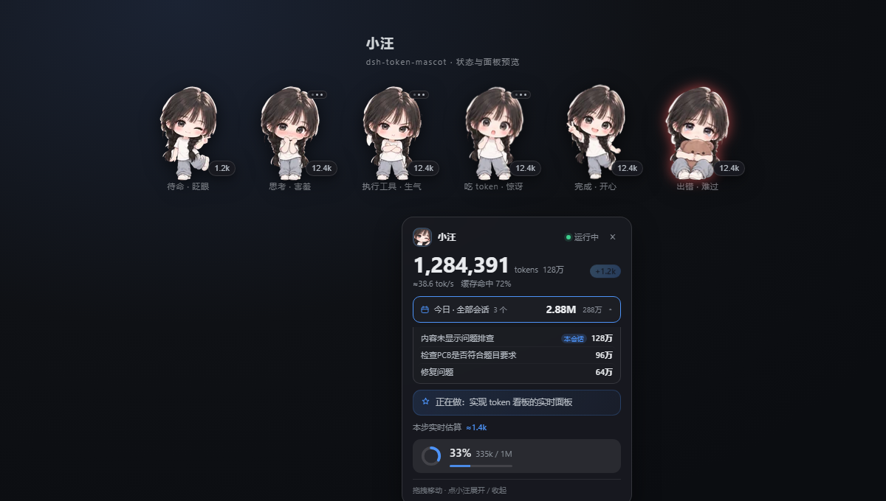
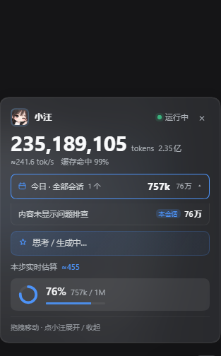
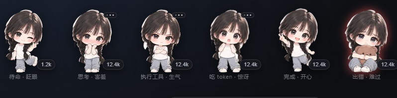
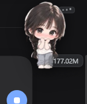

# 小汪 · DSH Token 看板娘

<p align="center">
  
</p>

<p align="center">
  <a href="https://github.com/zouyuhang233/dsh-token-mascot/stargazers"></a>
  <a href="https://github.com/zouyuhang233/dsh-token-mascot/releases/latest"></a>
  
  
  
</p>

给 [DeepSeek（DSH）](https://github.com/deepseek-ai/deepseek-harness) 用的右下角 Q 版看板娘：
实时显示**本会话 token 消耗、速率、上下文占用、当前任务**，以及**今日全部会话**合计（点开还能看各会话明细）。



> 小汪会一直待在窗口右下角。点她展开面板，拖拽可以移动；「今日 · 全部会话」点一下会展开各会话消耗。

---

## 目录

- [功能](#功能)
- [截图](#截图)
- [安装](#安装)
- [第一次使用](#第一次使用)
- [配置](#配置)
- [数字口径](#数字口径)
- [常见问题](#常见问题)
- [更新与卸载](#更新与卸载)
- [开发与验证](#开发与验证)
- [目录结构](#目录结构)
- [隐私](#隐私)
- [License](#license)

---

## 功能

| 区域 | 说明 |
| --- | --- |
| 本会话累计 | `tokenUsage` 投影：输入 + 缓存读/写 + 输出；`tokens` 后同时显示中文「万 / 亿」 |
| `+N` 气泡 | 每结算一步出现的增量 |
| 速率 | 运行中按流式增量估算；空闲时显示整会话解码均速 |
| 上下文条 | 上下文占用 / 窗口大小 / 百分比（卡片最下方） |
| 今日 · 全部会话 | 今日有活动的所有会话累计之和；点击展开各会话明细（本会话有标记） |
| 当前任务 | 出错 → 工具调用 → todo 进行中 → 思考中 → 待命 |
| 六种神情 | 眨眼（空闲）、害羞（思考）、生气（工具）、惊讶（吃 token）、开心（完成）、难过（出错） |

角色尺寸可在配置里调整，默认 112px。

## 截图

**真实面板**（本会话 `1.77亿`，今日全部会话 `2.65亿`，展开后的各会话明细）：

<p align="center"></p>

**六种神情**：



**右下角的角色**（展开时）：

<p align="center"></p>

---

## 安装

### 环境要求

- **DSH Desktop ≥ 0.2.1-rc.3**（旧版能用，但「今日 · 全部会话」会自动隐藏）
- 用「Git 地址」方式安装时，电脑上需要能访问 GitHub，DSH 自带的包管理器会通过 pnpm 拉取仓库
- 不需要安装 Node、不需要编译；插件产物已经构建好

### 方式一：Git 地址（推荐）

1. 打开 DSH：**设置 → 插件 → 添加插件**
2. 在输入框粘贴仓库地址：

   ```text
   https://github.com/zouyuhang233/dsh-token-mascot
   ```

3. 点 **安装**，等待完成
4. **完全退出并重开 DSH**（或刷新窗口）
5. 右下角出现小汪即安装成功

> **装不上 / 网络连不上 GitHub？** 用[方式二](#方式二下载-zip--release--本地路径)下载 Release 里的 zip，再用本地路径安装即可。

> 如果 DSH 提示「安装源 / registry」相关选项，保持默认即可；这是 Git 来源，不走 npm。

### 方式二：下载 ZIP / Release → 本地路径

1. 打开 **Releases** 下载现成压缩包（推荐）：

   <https://github.com/zouyuhang233/dsh-token-mascot/releases/latest>

   下载 `dsh-token-mascot-1.4.1-plugin.zip`；或者仓库页 **Code → Download ZIP** 下载源码包。
2. 解压，得到包含 `package.json` 的目录，例如 `dsh-token-mascot-1.4.1/` 或 `dsh-token-mascot-main/`
3. DSH：**设置 → 插件 → 添加插件**
4. 填这个目录的**本地绝对路径**：

   ```text
   C:\Users\你的用户名\Downloads\dsh-token-mascot-main
   ```

5. 安装后完全退出并重开 DSH

> 路径要选到**含 `package.json` 的那一层**，不要选到 `lib` 子目录。

### 方式三：本地安装脚本（开发者）

如果你是在自己的电脑上改源码，仓库根目录提供 `install.ps1`，会把本仓库的 `plugin/` 链接进 DSH desktop profile（并备份 profile）：

```powershell
powershell -NoProfile -ExecutionPolicy Bypass -File .\install.ps1 -WhatIf
powershell -NoProfile -ExecutionPolicy Bypass -File .\install.ps1
```

卸载：

```powershell
powershell -NoProfile -ExecutionPolicy Bypass -File .\install.ps1 -Uninstall
```

> 普通用户不需要这一步；用方式一或方式二即可。

### 方式四：npm（维护者发布后可用）

插件还没有发布到 npm。若之后发布，包名会是 `dsh-token-mascot`，届时在「添加插件」里只填包名即可。

---

## 第一次使用

1. 安装完成后**重开 DSH**，右下角出现小汪。
2. **点小汪**展开 / 收起卡片。
3. **拖拽小汪**可以换位置，位置会记住。
4. 点卡片里的「**今日 · 全部会话**」展开各会话消耗，再点收起（带过渡动画）。
5. 卡片里没显示「今日」也没关系：检查 DSH 版本是否 ≥ 0.2.1-rc.3。
6. 第一次打开时各会话投影按需加载，「今日」会先显示 `…` / `M+`，随后变成准确值。

---

## 配置

配置在 DSH profile 的补丁层里覆盖。打开（默认位置）：

```text
C:\Users\<你的用户名>\.dsh\profiles\desktop\cordis.patch.yml
```

在数组里加一项（已有的 `- id: ...` 同级）：

```yaml
- id: dsh-token-mascot
  config:
    mascot:
      collapsed: false        # 打开客户端时卡片是否默认展开
      showLiveEstimate: true  # 是否显示「本步实时估算」
      showContext: true       # 是否显示上下文占用条
      showTask: true          # 是否显示当前任务
      showToday: true         # 是否显示「今日 · 全部会话」
      size: 112               # 角色尺寸 px（64–220）
      offsetX: 18             # 默认位置：右边距
      offsetY: 104            # 默认位置：底边距
      accent: '#4d93f8'       # 强调色
```

保存后**重开 DSH** 生效。拖拽后的位置和展开状态另存在浏览器 localStorage，不受这里影响。

---

## 数字口径

- 大数字来自官方 `tokenUsage` 投影：**输入 + 缓存读 + 缓存写 + 输出**。缓存读往往占大头，所以数字看起来会比「新输入」大很多。
- 「今日 · 全部会话」= **今日有活动（`updatedAt` 在今天）的会话的会话累计之和**。DSH 的投影是会话级累计，没有按天切分；跨天会话会整段计入，一天内用完的会话就是当天消耗。
- 单位规则：**≥ 1 亿显示「亿」**（两位小数，如 `1.05亿`），**否则显示「万」**（如 `9725万`）。
- 花费在模型响应结束时才结算，所以大数字是「每步跳一次」；生成中的 `≈N` 是流式字符估算，结算后被精确值覆盖。

---

## 常见问题

<details>
<summary><b>插件页显示「运行中」，但右下角没有角色？</b></summary>

1. 安装/更新后要**完全退出并重开 DSH**，或至少刷新窗口（Ctrl+R）。
2. 确认 DSH 版本 ≥ 0.2.1-rc.3。
3. 看插件页里有没有「页面同步失败 / 重试」；有就点重试。
4. 如果仍然没有，把 DSH 开发者工具 Console 里的报错发到 Issues。
</details>

<details>
<summary><b>「今日 · 全部会话」不显示？</b></summary>

它依赖 DSH 0.2.1-rc.3+ 的全局 `useSessions` 和 `ctx.sessions.refreshProjections`。旧版会自动隐藏这一行，其余功能正常。
</details>

<details>
<summary><b>数字特别大，是不是算错了？</b></summary>

没算错。累计口径包含**缓存读**（命中缓存的 prompt 也计 token），通常会远大于新输入。看「缓存读」那一格和缓存命中率就能对上。
</details>

<details>
<summary><b>角色太大 / 卡片超出屏幕？</b></summary>

把配置里的 `size` 调小（如 96），或把 `offsetY` 调大；也可以直接拖拽角色到合适位置。
</details>

<details>
<summary><b>今日明细里的会话标题很长？</b></summary>

会省略显示；鼠标悬停可看完整标题和精确 token 数。
</details>

<details>
<summary><b>支持哪些 DSH 版本？</b></summary>

面向 DSH 0.2.1-rc.3 开发；旧版大部分功能可用，但「今日 · 全部会话」会隐藏。DSH 后续版本如果调整插件 API，我会在 Releases / Issues 里说明。
</details>

<details>
<summary><b>插件会联网吗？会上传我的数据吗？</b></summary>

不会。插件不发起任何网络请求，角色图片内嵌，所有数字都来自 DSH 宿主内存里的投影和事件。
</details>

---

## 更新与卸载

**更新**（Git / 本地路径安装）：

1. 在插件页卸载旧版本（或直接重新安装新版本）
2. 重新按「安装」步骤添加
3. 重开 DSH

版本变化见 [CHANGELOG.md](CHANGELOG.md)。

**卸载**：

- 插件页 → 插件 → 卸载；
- 或本地安装脚本：`.\install.ps1 -Uninstall`。

---

## 开发与验证

不需要构建：浏览器侧是单文件 `plugin/lib/client.js`，角色图已内嵌为 WebP data URI。

```powershell
# 静态契约校验（manifest / patch / 产物标志 / require 白名单 / 纯函数）
node test/validate.mjs

# 重新生成离线预览页 preview/preview.html（需要 Node）
node preview/build-preview.mjs
```

浏览器契约测试：直接用浏览器打开 `test/harness.html`，应显示 `ALL PASS`。

仓库根目录的 `package.json` 是给 DSH / npm 用的包入口：
- `main` / `exports` 指向 `plugin/lib/*`
- `dsh.bundle.patch` 指向 `plugin/cordis.patch.yml`
- `dsh.client.platform = "web"`

所以 **Git 地址安装时仓库根目录就是插件包**，不需要额外构建步骤。

---

## 目录结构

```text
dsh-token-mascot/
├─ package.json             DSH / npm 包入口（指向 plugin/）
├─ plugin/                 可安装的插件包
│  ├─ package.json
│  ├─ cordis.patch.yml      Loader 行 + 可调配置
│  └─ lib/
│     ├─ index.js          宿主侧：空 apply + 产物静态审计
│     └─ client.js         浏览器侧：角色 + 面板 + 数据接线（含内嵌 WebP）
├─ test/                   静态契约校验 validate.mjs + 浏览器 harness.html
├─ preview/                离线预览页、角色大图、6 神情 sprites + 生成脚本
├─ docs/images/            README 用的截图
├─ install.ps1 / install.cmd / rollback.*
├─ CHANGELOG.md
└─ README.md
```

---

## 隐私

- 不发起任何网络请求；
- 角色素材已内嵌，无外部图片/字体/CDN；
- 所有 token 数字来自 DSH 宿主的内存投影与事件，不写入外部服务。

## License

MIT。角色素材由作者提供并在本地处理；面板 SVG/CSS 为原创；插件契约形状参考 DSH 官方包，未复制第三方代码。
